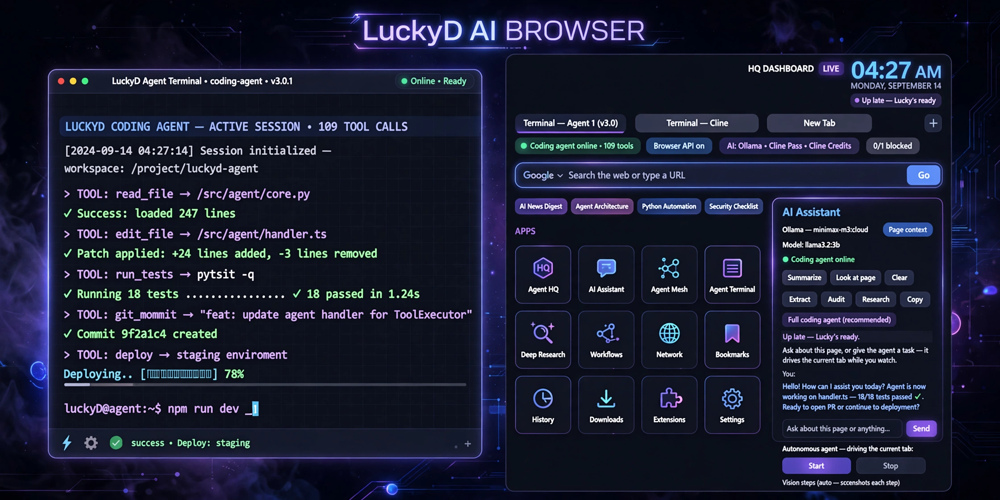

<div align="center">

# LuckyD Browser

**The Chromium browser with a real AI assistant built in — free to use, private by design, and yours to rename.**

[](https://github.com/Dylanchess0320/LuckyD-Browser/releases/latest)
[](LICENSE)
[](https://github.com/Dylanchess0320/LuckyD-Browser/releases/latest)

### [⬇ Download LuckyD Browser for Windows](https://github.com/Dylanchess0320/LuckyD-Browser/releases/latest)

**[📝 Changelog](CHANGELOG.md)** · **[📖 Documentation](https://dylanchess0320.github.io/LuckyD-Browser/)** · **[💬 Discord](https://discord.gg/CmvErK8bkM)**

</div>

---

## Why LuckyD?

Most AI browsers rent you a chatbot on a subscription. LuckyD takes the other road: it's a full Chromium daily driver with an AI layer that **finds you a working model for free** — a rotating pool of free cloud models first, local models on your own machine when you want total privacy, and your own API keys only if you choose to add them.

- 🆓 **Free AI, no catch** — no account, no API key, no subscription. The assistant works the moment you install.
- 🌐 **A real browser** — Chromium engine, tabs, bookmarks, workspaces, built-in ad blocking, private mode.
- 🔒 **Private by default** — no telemetry, no tracking. Local-only mode keeps every prompt on your machine.
- 🎨 **Yours, visually** — hand-built themes including Arctic Light, animated homepages you can switch off, and a setting to rename the browser itself.

> Other AI browsers rent you their chatbot. **LuckyD finds you a free one — or runs one on your machine.**

---

## The AI Assistant

Press `Ctrl+Shift+A` on any page. One input bar, two modes, toggled right where you type:

- **Ask** — questions about the page or anything else. Summarize an article, explain a paragraph, draft a reply.
- **Agent** — hand it a task. It works through the browser's toolset and reports back in the transcript, with a live status line while it runs.

Behind both modes sits provider handling that tells the truth. Settings → Models shows every provider's live status — **Ready**, **Needs key**, or **Exhausted** (with a retry countdown) — read from the same health snapshot the backend uses. When a model dies mid-request, the run rotates to the next working one instead of ending in an empty reply. The free Cline rotation (MiMo v2.6 Pro among the models it serves) is the default path; plug in Ollama for fully local models, or add your own keys for Gemini, OpenAI, Anthropic, OpenRouter, DeepSeek, and more — cloud providers are always an explicit opt-in, never a silent fallback.

---

## Multi Agent Terminal

A real terminal built into the browser, made for coding agents. Open a tab, pick your CLI, and run several agents side by side — each in its own live session. The `/model` picker spans the whole catalog in one list: your local Ollama models and the free cloud rotation together, so switching brains mid-session is one command, not a settings expedition.

---

## Made to be yours

- **Themes** — a considered set of looks, from the deep default to **Arctic Light**, all drawn from one design-token system so every surface matches.
- **Animated homepages** — Aurora Glow, Particle Drift, and Gentle Parallax bring the start page to life and follow your cursor. Prefer calm? One switch turns animation off completely.
- **Rename your browser** — Settings → the display name is yours. The window, the menus, and the identity follow what you call it.
- **Ctrl+K command palette** — every command, tab, bookmark, and history entry in one search box, each row labeled for what it is.

## A proper daily driver

Underneath the AI, this is a browser built for everyday use: fast tab handling with the tab strip where it belongs, bookmarks and history, workspaces, a built-in ad blocker, private windows that write nothing to disk, and per-site permission controls (Tools → Site Permissions) so you decide exactly what each site may touch.

## Community

LuckyD is built in the open, with its users. **[Join the Discord](https://discord.gg/CmvErK8bkM)** for release chatter, feature ideas, and help getting set up — or open a [GitHub issue](https://github.com/Dylanchess0320/LuckyD-Browser/issues) when something breaks.

---

## Install in 3 steps

1. **[Download the installer](https://github.com/Dylanchess0320/LuckyD-Browser/releases/latest)** (Windows 10/11, 64-bit)
2. Run it — installs for just you, **no admin needed**
3. Open LuckyD and press `Ctrl+Shift+A` — the AI works right away on free providers

Then start chatting. That's it. Want everything on your own machine? Add Ollama in Settings → Models for local-only mode.

<p align="center">
  
</p>

---

## What's new

**v10.8.3** — The cleanup pass: Ctrl+K palette rebuilt, model pickers list only working models (your luckyd models first), status bar slimmed down with the hover address kept, LuckyD Chat retired for now, GitHub page rewritten as a showcase with the Discord invite back

**v10.8.2** — Agent mode fixed: AI Assistant agent runs use the provider + model you picked (Cline included), and a model that fails mid-request rotates to the next one instead of ending in an empty reply

Older changes: [full changelog](CHANGELOG.md) · [all releases](https://github.com/Dylanchess0320/LuckyD-Browser/releases)

---

<details>
<summary><b>For developers</b> — build from source, shortcuts, architecture</summary>

### Shortcuts

| Shortcut | Action |
|----------|--------|
| `Ctrl+Shift+A` | AI Assistant |
| `Ctrl+K` | Command palette |
| `Ctrl+T` | New tab |
| `Ctrl+W` | Close tab |

### Build from source

```powershell
git clone https://github.com/Dylanchess0320/LuckyD-Browser.git
cd LuckyD-Browser
pip install -r browser\requirements.txt
browser\run_browser.bat
```

### Architecture

```
browser/   PySide6 / Qt WebEngine (Chromium) · Control API :9777 · Terminal :9881
core/      agent loop, LLM client, checkpoints
main.py    luckyd terminal CLI (/model picker, free rotation, local + cloud)
tests/     headless pytest (Qt mocked on Linux CI)
```

### The trust layer (`kit/`)

Don't rebuild agent trust plumbing — build *with* ours. [`kit/`](kit/) ships LuckyD's permission scopes, approval engine, secret redaction, and audit log as a stdlib-only Python package, plus installable skills that work in LuckyD, Claude Code, OpenCode, and Codex CLI. See [`kit/SKILL_AUTHORING.md`](kit/SKILL_AUTHORING.md).

### Privacy

- Local-first: prompts never leave your machine unless you pick a cloud provider
- Control API and terminal bridge bind to `127.0.0.1` only
- No telemetry, no bundled API keys

</details>

---

<p align="center">
  <b>MIT © LuckyD</b><br>
  <a href="https://github.com/Dylanchess0320/LuckyD-Browser/releases/latest">Download</a>
  · <a href="https://discord.gg/CmvErK8bkM">Discord</a>
  · <a href="https://www.youtube.com/@LuckyDYoutube">YouTube</a>
  · <a href="CHANGELOG.md">Changelog</a>
</p>
